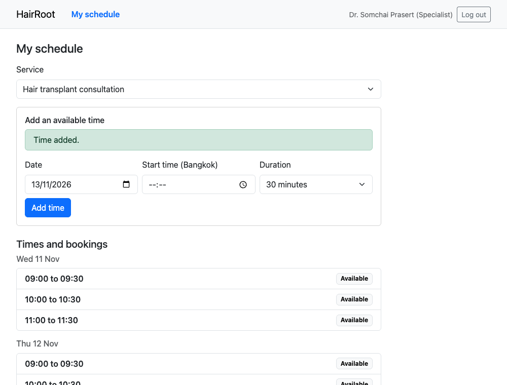
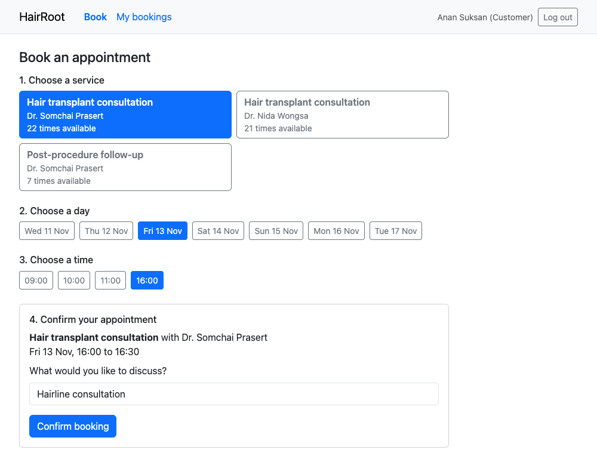
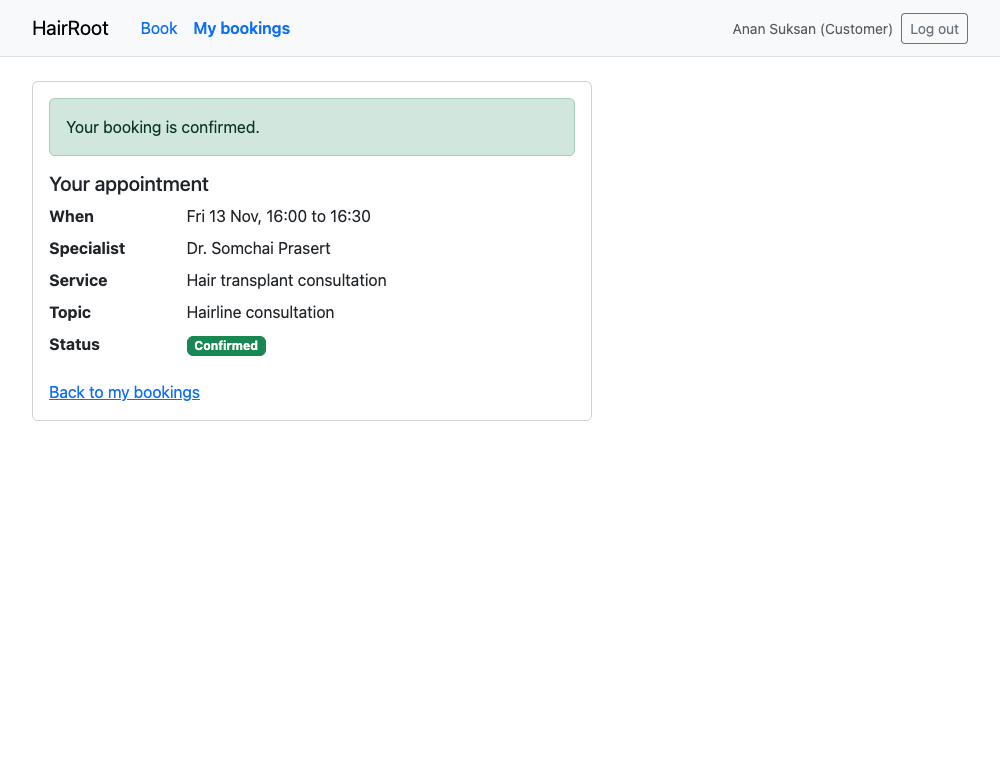
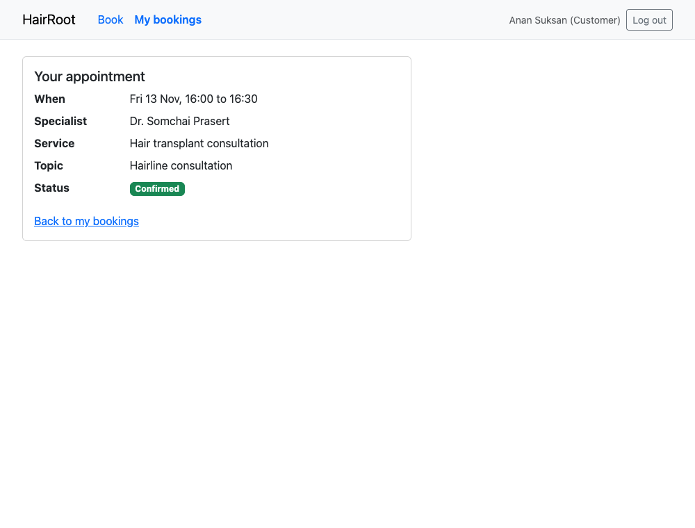
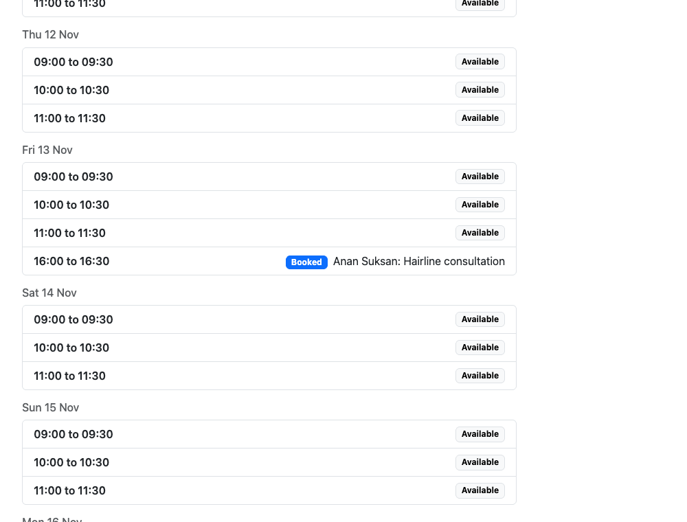
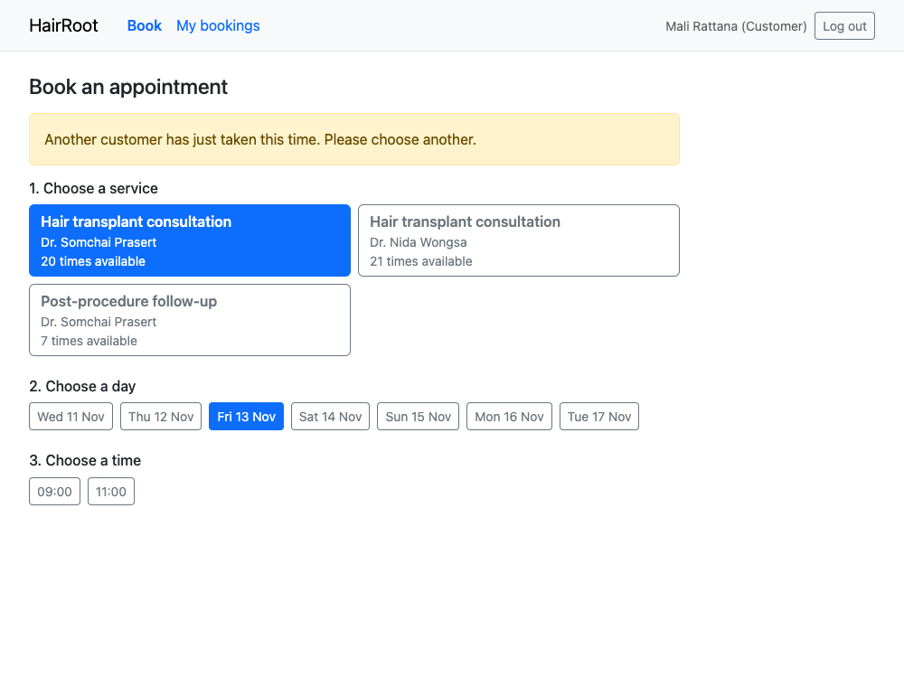
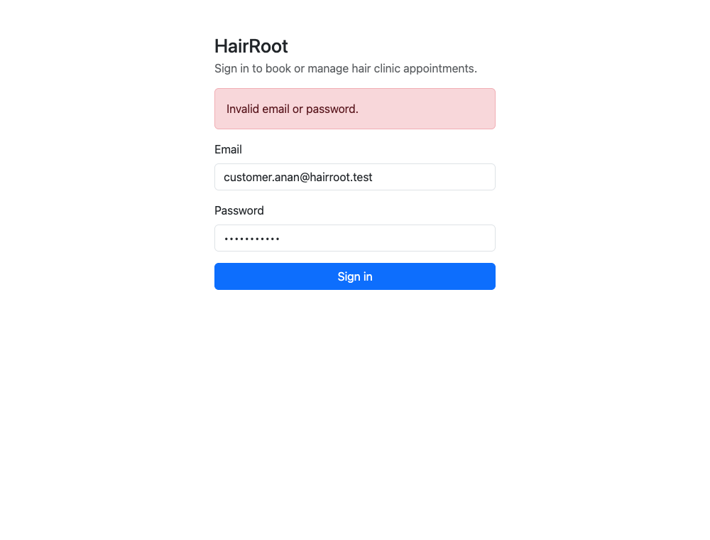
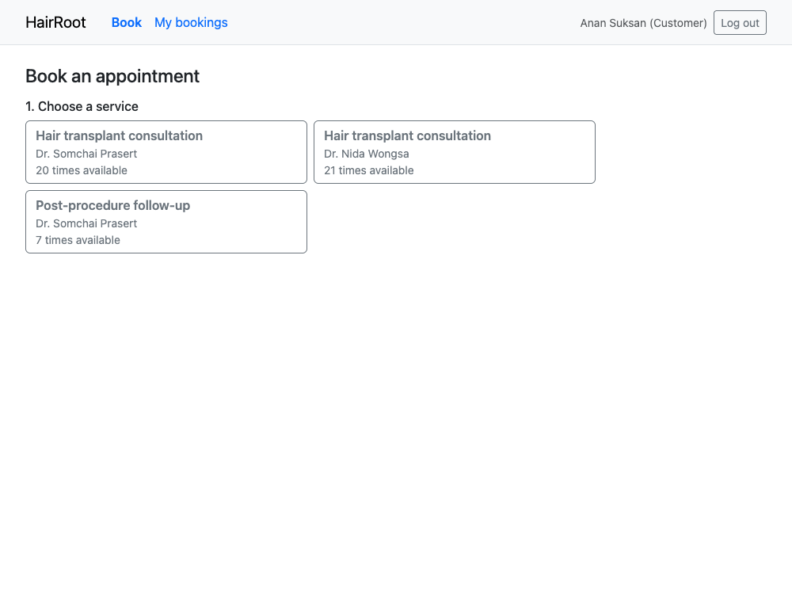
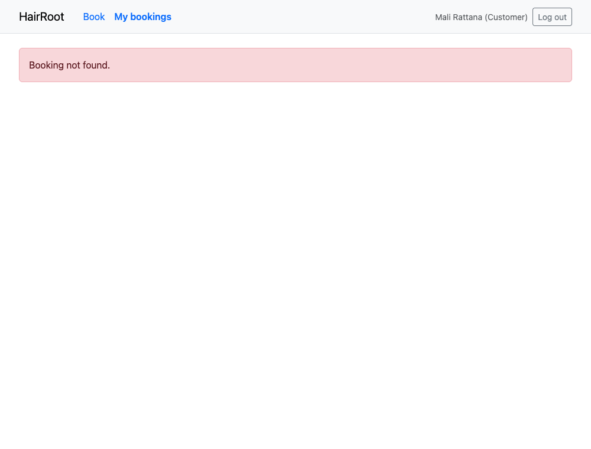

All execution evidence identifies its commit.

## F.1 Setup summary

| Item | Value |
|---|---|
| Dependencies | Node.js 20 or later, npm, Docker, Git |
| Environment variables | Server: `DATABASE_URL`, `PORT`, `CLIENT_ORIGIN`, `NODE_ENV`. Client: `VITE_API_URL`. Local examples are in `.env.example` files. |
| Database | PostgreSQL 16 in Docker on port 5435; `npm run db:migrate`, then `npm run db:seed` |
| Run | `cd server && npm run dev`, and `cd client && npm run dev` |
| Build | `cd server && npm run build`, and `cd client && npm run build` |
| Test | `cd server && npm test`, and `cd client && npm test`, and `cd e2e && npm test` |
| Test accounts | Synthetic accounts from the documented local seed procedure in the README |

## F.2 Program demonstrations

All scenarios use release `d1e8d81` (tag `v0.1.0-sprint1`), with a freshly seeded local database.

### Scenario 1: Normal journey and retrieval

| | |
|---|---|
| **Feature and AC** | F-03, F-04, F-05; AC-10, AC-14, AC-15, AC-20, AC-22 |
| **Roles** | Specialist, then Customer, then Specialist |
| **Starting conditions** | Freshly seeded database |
| **Steps** | The specialist adds a time. The customer books it and reopens it from My bookings. The specialist sees the booking. |
| **Expected result** | The saved booking is retrieved by the customer and shown on the specialist's schedule. |
| **Actual result** | As expected. T-31 passed at the release, covering this journey through the UI, API, and database. |



*Step 1. The specialist adds a time.*



*Step 2. The customer chooses a service, day, and time, then enters a topic.*



*Step 3. The booking is confirmed.*



*Step 4. The customer reopens the saved booking from My bookings.*



*Step 5. The specialist sees the booking, with the customer name and topic, after reloading the schedule.*

### Scenario 2: Business-rule rejection

| | |
|---|---|
| **Feature and AC** | F-04; AC-16 |
| **Role** | Customer |
| **Starting conditions** | A customer has the available list open, and the slot is then booked by another customer. |
| **Steps** | The customer confirms a booking for the slot that was just taken. |
| **Expected result** | 409 `SLOT_TAKEN`, a clear message, a refreshed list, and the original booking unchanged. |
| **Actual result** | As expected. T-32 passed at the release, and the API returned 409 `SLOT_TAKEN` (scenario 3 output). |



*Another customer booked the same time first. This customer sees the rejection, and that time is no longer offered.*

### Scenario 3: Login, logout, and forbidden operations

| | |
|---|---|
| **Feature and AC** | F-01, F-02, F-05; AC-01, AC-02, AC-03, AC-06, AC-21, AC-23 |
| **Roles** | Customer and Specialist |
| **Starting conditions** | Freshly seeded database |
| **Steps** | Log in with a wrong and then a correct password, log out, and call another user's booking and another specialist's schedule through the API. |
| **Expected result** | 401 for the wrong password, then a session; 401 after logout; 404 for another customer's booking; 403 for an unassigned schedule. |
| **Actual result** | As expected. See the API output below, and T-02, T-03, T-05, T-06, T-21, and T-23 at the release. |

**Backend evidence from the release.** Long responses are shortened with `...`.

```text
API evidence at commit d1e8d81 (local, synthetic data)

$ POST /api/auth/login, wrong password
{"error":"Invalid email or password.","code":"INVALID_CREDENTIALS"}
-> HTTP 401

$ POST /api/auth/login, correct password
{"user":{"id":53,"name":"Anan Suksan","email":"customer.anan@hairroot.test","role":"CUSTOMER"}}
-> HTTP 200

$ POST /api/bookings as customer.anan (slot 375)
{"booking":{"id":7,"status":"ACTIVE","topic":"Hairline consultation","createdAt":"2026-11-10T14:35:51.372Z","slot":{"id":375,"startAt":"2026-11-11T02:00:00.000Z","endA...
-> HTTP 201

$ POST /api/bookings, same slot, as customer.mali
{"error":"Another customer has just taken this time.","code":"SLOT_TAKEN"}
-> HTTP 409

$ GET /api/bookings/7 as customer.anan (owner)
{"booking":{"id":7,"status":"ACTIVE","topic":"Hairline consultation","createdAt":"2026-11-10T14:35:51.372Z","slot":{"id":375,"startAt":"2026-11-11T02:00:00.000Z","endA...
-> HTTP 200

$ GET /api/bookings/7 as customer.mali (not owner)
{"error":"Booking not found.","code":"NOT_FOUND"}
-> HTTP 404

$ GET /api/schedules/31/slots as specialist.nida (not assigned)
{"error":"You do not have permission to do that.","code":"FORBIDDEN"}
-> HTTP 403

$ GET /api/schedules/mine as customer.anan (wrong role)
{"error":"You do not have permission to do that.","code":"FORBIDDEN"}
-> HTTP 403

$ GET /api/bookings/mine with no session
{"error":"Authentication required.","code":"UNAUTHENTICATED"}
-> HTTP 401

$ POST /api/auth/logout as customer.mali
-> HTTP 204

$ GET /api/auth/me with the logged-out session
{"error":"Authentication required.","code":"UNAUTHENTICATED"}
-> HTTP 401
```



*A wrong password is rejected.*



*A correct password signs the customer in.*



*Another customer's booking address shows Booking not found.*


*After logout, opening a protected page returns to the login page.*

## F.3 Build and automated test results

Tested commit: `d1e8d81` (tag `v0.1.0-sprint1`).

```text
$ cd server && npm test
 ✓ tests/bookings.api.test.ts (8 tests) 1554ms
   ✓ booking > T-17 lets exactly one of 20 competing customers book the slot (AC-17) 444ms
 ✓ tests/booking-views.api.test.ts (6 tests) 1592ms
   ✓ booking views and access control > T-20 lists only the customer's own bookings and opens one (AC-20) 312ms
 ✓ tests/auth.api.test.ts (8 tests) 687ms
 ✓ tests/slots.api.test.ts (8 tests) 1307ms
 ✓ tests/slots.unit.test.ts (2 tests) 2ms
 ✓ tests/password.unit.test.ts (1 test) 182ms
 Test Files  6 passed (6)
      Tests  33 passed (33)

$ cd server && npm run typecheck && npm run build
exit 0, no errors

$ cd client && npm test
 ✓ tests/screen-states.test.tsx (3 tests) 111ms
 ✓ tests/booking-flow.test.tsx (1 test) 194ms
 Test Files  2 passed (2)
      Tests  4 passed (4)

$ cd client && npm run build
✓ built in 621ms

$ cd e2e && npm test
  ✓  1 tests/sprint-1.spec.ts:89:1 › T-30 logs in, logs out, and redirects a protected route to login (1.1s)
  ✓  2 tests/sprint-1.spec.ts:103:1 › T-31 specialist creates a slot, customer books and reopens it, specialist see
  ✓  3 tests/sprint-1.spec.ts:125:1 › T-32 shows a conflict and refreshes the times when another customer books fir
  3 passed (8.1s)
```

**Result:** server 33 passed, client 4 passed, end-to-end 3 passed, with 0 failed and 0 skipped. Commands were run from a fresh clone of the release commit. Full output is in `docs/sprints/sprint-1/evidence/release/`.

### AC-to-test results

Results are from the release commit `d1e8d81`. Manual checks are labelled Manual, and all others are automated.

| AC | Test | Type | File and test | Result |
|---|---|---|---|---|
| AC-01 | T-01 | Automated | `server/tests/auth.api.test.ts` | Passed |
| AC-02 | T-02 | Automated | `server/tests/auth.api.test.ts` | Passed |
| AC-03 | T-03 | Automated | `server/tests/auth.api.test.ts` | Passed |
| AC-04 | T-04 | Automated | `server/tests/auth.api.test.ts` | Passed |
| AC-05 | T-05 | Automated | `server/tests/booking-views.api.test.ts` | Passed |
| AC-06 | T-06 | Automated | `server/tests/booking-views.api.test.ts` | Passed |
| AC-07 | T-07a, T-07b | Automated | `server/tests/password.unit.test.ts`, `auth.api.test.ts` | Passed |
| AC-08 | T-08 | Automated | `server/tests/auth.api.test.ts` | Passed |
| AC-10 | T-10 | Automated | `server/tests/slots.api.test.ts` | Passed |
| AC-11 | T-11a, T-11b | Automated | `server/tests/slots.unit.test.ts`, `slots.api.test.ts` | Passed |
| AC-12 | T-12a, T-12b, T-12c | Automated | `server/tests/slots.api.test.ts` | Passed |
| AC-13 | T-13 | Automated | `server/tests/slots.api.test.ts` | Passed |
| AC-14 | T-14 | Automated | `server/tests/bookings.api.test.ts` | Passed |
| AC-15 | T-15 | Automated | `server/tests/bookings.api.test.ts` | Passed |
| AC-15b | T-15b | Automated | `server/tests/bookings.api.test.ts` | Passed |
| AC-16 | T-16 | Automated | `server/tests/bookings.api.test.ts` | Passed |
| AC-16 | T-32 | End-to-end | `e2e/tests/sprint-1.spec.ts` | Passed |
| AC-17 | T-17 | Automated | `server/tests/bookings.api.test.ts` | Passed |
| AC-18 | T-18 | Automated | `server/tests/bookings.api.test.ts` | Passed |
| AC-19 | T-19 | Automated | `server/tests/bookings.api.test.ts` | Passed |
| AC-20 | T-20 | Automated | `server/tests/booking-views.api.test.ts` | Passed |
| AC-21 | T-21 | Automated | `server/tests/booking-views.api.test.ts` | Passed |
| AC-22 | T-22 | Automated | `server/tests/booking-views.api.test.ts` | Passed |
| AC-23 | T-23 | Automated | `server/tests/booking-views.api.test.ts` | Passed |
| AC-24 | M-01 | Manual | Restart check: identical response before and after restart (`evidence/release/m-01.txt`) | Passed |
| AC-25 | M-02 | Manual | Pattern search of tracked files and history found no credentials; only `.env.example` files are tracked (`evidence/release/m-02.txt`) | Passed |
| AC-26 | T-26 | Automated | `client/tests/screen-states.test.tsx` | Passed |
| AC-27 | T-27 | Automated | `client/tests/booking-flow.test.tsx` | Passed |
| AC-01, AC-03 | T-30 | End-to-end | `e2e/tests/sprint-1.spec.ts` | Passed |
| AC-10, AC-14, AC-15, AC-20, AC-22 | T-31 | End-to-end | `e2e/tests/sprint-1.spec.ts` | Passed |

## F.4 Test excerpts and TDD evidence

### Excerpt 1: domain rule (T-17, BR-01)

`server/tests/bookings.api.test.ts`

```ts
it("T-17 lets exactly one of 20 competing customers book the slot (AC-17)", async () => {
  const free = await slot(24);
  const cookies = await Promise.all(
    Array.from({ length: 20 }, async (_, i) => {
      const email = `competitor${i}@example.test`;
      await createUser("CUSTOMER", email);
      return loginAs(email);
    })
  );
  const results = await Promise.all(cookies.map((cookie) => book(cookie, free.id)));
  const statuses = results.map((r) => r.status);
  expect(statuses.filter((s) => s === 201)).toHaveLength(1);
  expect(statuses.filter((s) => s === 409)).toHaveLength(19);
  expect(await activeRows(free.id)).toBe(1);
}, 30_000);
```

**Red, commit `8394498`:**

```text
FAIL  tests/bookings.api.test.ts > booking > T-17 lets exactly one of 20 competing students book the slot (AC-17)
AssertionError: expected [ 201, 201, 201, 201, 201, 201, …(14) ] to have a length of 1 but got 20
```

**Green, commit `f445527`:** the test passes after adding the partial unique index. It was named with "students" before change C-01.

### Excerpt 2: ownership restriction (T-21, BR-06)

`server/tests/booking-views.api.test.ts`

```ts
it("T-21 hides another customer's booking behind a 404 (AC-21)", async () => {
  const res = await api().get(`/api/bookings/${bobBooking}`).set("Cookie", alice);
  expect(res.status).toBe(404);
  expect(res.body.code).toBe("NOT_FOUND");
  expect(JSON.stringify(res.body)).not.toContain("Bob private topic");
  const missing = await api().get("/api/bookings/999999").set("Cookie", alice);
  expect(missing.body).toEqual(res.body);
  expect(missing.status).toBe(404);
});
```

**Red, commit `95a09e8`:**

```text
FAIL  tests/booking-views.api.test.ts > booking views and access control > T-21 hides another student's booking behind a 404 (AC-21)
AssertionError: expected 200 to be 404 // Object.is equality
```

**Green, commit `47664bf`:** the test passes after scoping the query to the session's user.

### TDD summary

| Feature | Red commit | Failure before implementation | Green commit | Run after green |
|---|---|---|---|---|
| F-01 | `62331d1` | Test suites could not load, because the modules did not exist | `0d109d2` | 9 of 9 passed |
| F-03 | `328b124` | 6 of 19 failed: for example, 201 where 409 is required | `aadeff4` | 19 of 19 passed |
| F-04 | `8394498` | 6 of 27 failed: all 20 competing requests booked the slot | `f445527` | 27 of 27 passed |
| F-05 | `95a09e8` | 3 of 33 failed: 200 where 403 and 404 are required | `47664bf` | 33 of 33 passed |

Full red and green outputs are in `docs/sprints/sprint-1/evidence/`.

## F.5 Engineering workflow and history

### Sampled Issues and PRs

| | Sample 1 | Sample 2 |
|---|---|---|
| **Feature and contract** | F-04, `F-04-booking.md` | F-05, `F-05-booking-views.md` |
| **Issue** | #4 | #5 |
| **Branch** | `feature/4-booking` | `feature/5-booking-views` |
| **PR** | #15 | #16 |
| **Author and reviewer** | `alvin777777`, `Ohmmykung09` | `alvin777777`, `Ohmmykung09` |
| **Substantive review** | Approved. Reviewed `createBooking`, the partial unique active-booking index, and T-14 to T-19, especially the 20-request race and session-derived ownership. Ran the server tests (27 passed) against PostgreSQL, plus typecheck and builds. Confirmed the F-03 typing fix. | Approved. Reviewed `getOwnedBooking`, `assignedSchedule`, response serialisation, T-05, T-06, T-20 to T-23, and T-26. Ran the server tests (33) and client tests (3). Confirmed that another customer's booking returns the same 404 body as a missing ID. |
| **Staging merge** | `c026e16`, 2026-11-07 23:52, merged by `Ohmmykung09` | `92cb886`, 2026-11-07 23:54, merged by `Ohmmykung09` |
| **Release on main** | PR #25, `d1e8d81`, tag `v0.1.0-sprint1` | PR #25, `d1e8d81`, tag `v0.1.0-sprint1` |

**Issue, PR, review, release, and board data**, taken from the GitHub API with the `gh` CLI on 10 November 2026:

```text
Issue #4 [CLOSED] F-04: Booking
PR #15 [MERGED] feat: exclusive booking (F-04)
  branch: feature/4-booking  author: alvin777777  merged by: Ohmmykung09 at 2026-11-07T16:52:31Z (c026e16)
  review: Ohmmykung09 APPROVED at 2026-11-07T16:54:03Z

Issue #5 [CLOSED] F-05: Booking views
PR #16 [MERGED] feat: booking views and ownership (F-05)
  branch: feature/5-booking-views  author: alvin777777  merged by: Ohmmykung09 at 2026-11-07T16:54:19Z (92cb886)
  review: Ohmmykung09 APPROVED at 2026-11-07T16:54:14Z

Release PR #25 [MERGED] release: Sprint 1: sprint-1-staging -> main
  author: alvin777777  merged by: Ohmmykung09 at 2026-11-10T14:08:21Z (d1e8d81)
  review: Ohmmykung09 APPROVED at 2026-11-10T14:08:17Z

Project board: HairRoot Sprint 1
  #1 Done: Product baseline and Sprint 1 contracts (Parts A-E)
  #2 Done: F-01, F-02: Authentication and access control
  #3 Done: F-03: Slot creation
  #4 Done: F-04: Booking
  #5 Done: F-05: Booking views
  #6 Done: C-01: Change the context to the HairRoot hair clinic
  #7 Done: README and setup instructions
  #8 Done: E2E tests T-30, T-31, T-32
  #9 Todo: Try the app in a browser and fix what breaks
  #10 Done: Sprint 1 integration, manual checks, and release
  #11 In Progress: Deliverable 1 PDF
  #21 Done: Make the booking workflow work like a real booking app

Tag: v0.1.0-sprint1 d1e8d81 2026-11-10 21:36:49 +0700
```

### Contract and implementation sequence

| Date and time (Bangkok) | Commit | Step |
|---|---|---|
| 2026-11-07 23:05 | `141f3a6` | Baseline and all Sprint 1 contracts recorded, before any code |
| 2026-11-07 23:07 | `62331d1` | F-01 failing tests |
| 2026-11-07 23:09 | `0d109d2` | F-01 and F-02 implementation |
| 2026-11-07 23:10 | `328b124` | F-03 failing tests |
| 2026-11-07 23:11 | `aadeff4` | F-03 implementation |
| 2026-11-07 23:11 | `8394498` | F-04 failing tests |
| 2026-11-07 23:12 | `f445527` | F-04 implementation |
| 2026-11-07 23:13 | `95a09e8` | F-05 failing tests |
| 2026-11-07 23:13 | `47664bf` | F-05 implementation |
| 2026-11-07 23:20 | `1f408ee` | Context change C-01 |
| 2026-11-07 23:45 to 23:56 | `899dbb0` to `d9139cf` | Teammate reviews and merges PRs #12 to #18 into `sprint-1-staging` |
| 2026-11-08 00:14 | `f5931b3` | Teammate's E2E tests T-30 to T-32 (#19) |
| 2026-11-08 00:44 | `241f76e` | C-02 contract revision and failing T-27, after the teammate asked for a real booking-app workflow |
| 2026-11-08 00:46 | `7eb4001` | C-02 implementation |
| 2026-11-09 17:53 | `736584c` | Teammate's E2E tests (#19) adapted to C-02 |
| 2026-11-09 19:00 to 19:06 | `90a73db`, `2ac6bf6` | Teammate merges #19 and, after review, #22 into `sprint-1-staging` |
| 2026-11-10 21:08 | `d1e8d81` | Teammate reviews and merges release PR #25 into `main`; tagged `v0.1.0-sprint1` |

These commits were made with an AI agent, which explains the short intervals.

## F.6 Contributions, AI use, and limitations

### Contributions

| Student | Contribution |
|---|---|
| ไอโว ปีเตอร์ อัลวิน รันเน่ | Ran the release checks and tagged the release, and captured the demonstrations. Supervised and authored PRs for the baseline, contracts, F-01 to F-05, the context change C-01, the README, and the guided workflow C-02 (#22). Reviewed the teammate's PRs #19, #20, and #24. Owns this PDF. |
| ทิฐินันท์ สอบกิ่ง | Reviewed and merged PRs #12 to #18 after running their tests, finding the missing test-database setup step (#18) and confirming the F-03 typecheck fix (#14). Wrote the E2E tests T-30 to T-32 (#19). After trying the app, requested the guided booking workflow (C-02). Proposed F-16 for Sprint 2 with its contract (#24, #20). Reviewed and merged #22 and release PR #25. Outside this release, opened Issue #23 and authored the F-16 Sprint 2 contract (#24) and draft implementation (#20). |

### AI-use declaration

| Tool | Tasks assisted |
|---|---|
| Claude Code (Claude Opus 5.5), used by ไอโว | Drafted the SRS, SDS, plan, and contracts; wrote server and client code and tests; ran commands; created Issues and PRs; drafted reviews of #19, #20, and #24 after running their tests; captured the screenshots with a browser script; built this PDF. |

| Tool | Tasks assisted |
|---|---|
| OpenAI Codex (GPT-6), used by ทิฐินันท์ | Assisted with authoring T-30 to T-32 in PR #19 and reviewing PRs #12 to #18, #22, and #25, including code and document inspection and test-result assessment. |

### Known limitations and incomplete work

- At the release, no required test failed or was skipped.
- The teammate could not rerun the database-backed API and end-to-end tests while reviewing #22 and #25, because Docker was unavailable on that machine, and said so in those reviews. Those tests were run on a fresh clone of each commit by ไอโว.
- GitHub reports no automated checks on these branches, because CI is established in Lab 5. Test results come from local runs tied to the commits shown.
- The context changed from academic advising to a hair clinic after Sprint 1 was implemented (C-01). Contracts version 0.2 and the code were renamed, and behaviour did not change. Earlier commits and evidence keep the old names.
- The context was not confirmed with the instructor or TA (SRS Q-01). The team proceeded because the brief gives consultation as an example.
- Commit `aadeff4` had a TypeScript typecheck error, corrected in `f445527`. Its tests passed.
- T-12c was added to the STS during F-03 to cover competing overlap requests.
- At the release tag, `docs/system-sds.md` §2 names the seed command as `npm run prisma:seed`. The actual command is `npm run db:seed`, which this PDF and the README use. The teammate found this during PDF review.
- Docker, CI/CD, and GCP deployment are not included, and are due in Lab 5.
- C-02 changed the customer and specialist screens after the first Sprint 1 implementation, at the teammate's request. The contract revision and failing test came before the change.
- PRs #20 and #24 (F-16, public booking pulse) are a Sprint 2 proposal and are not part of this release.
- Cancellation, rescheduling, and the other later features are planned for Sprints 2 and 3.
