# CPE 334 Lab 5: Cloud Deployment and CI/CD Pipeline on GCP

**HairRoot**, hair clinic appointment booking (Group Project Theme 1). [PENDING: section and group name]

## Answer Part 0: Team and Evidence Index

| | |
|---|---|
| **Students** | ไอโว ปีเตอร์ อัลวิน รันเน่, 67070501051, GitHub `alvin777777`<br>ทิฐินันท์ สอบกิ่ง, 67070501018, GitHub `Ohmmykung09` |
| **Repository (public)** | https://github.com/alvin777777/hairroot |
| **Starting point** | Sprint 1 release `v0.1.0-sprint1`, commit `d1e8d81` |
| **Submitted release** | `main` at commit `ac0a57b9eb871128807733a0e9d75d77a662b477` (release PR #52) |
| **Public URL** | https://hairroot-368003298307.asia-southeast1.run.app |
| **Running revision and commit** | `hairroot-sha-ac0a57b9eb87-44992339630-1` serves `ac0a57b`, deployed by [run 44992339630](https://github.com/alvin777777/hairroot/actions/runs/44992339630). The live `/api/version` and the page footer report the same commit. |
| **GCP project** | `cpe334-hairroot`, region `asia-southeast1` |
| **Deployment guide** | [docs/labs/lab-05/deployment.md](https://github.com/alvin777777/hairroot/blob/sprint-1-staging/docs/labs/lab-05/deployment.md) |

### Contributions

| Work | Issue | Pull Request | Author | Reviewer |
|---|---|---|---|---|
| GCP account, project, budget, IAM | [#27](https://github.com/alvin777777/hairroot/issues/27) | Console, no branch | ทิฐินันท์ (Owner); ไอโว added as Editor | — |
| Cloud-ready app | [#28](https://github.com/alvin777777/hairroot/issues/28) | [#36](https://github.com/alvin777777/hairroot/pull/36) | ไอโว | ทิฐินันท์ |
| Docker | [#29](https://github.com/alvin777777/hairroot/issues/29) | [#37](https://github.com/alvin777777/hairroot/pull/37) | ไอโว | ทิฐินันท์ (found the Windows CRLF defect; re-reviewed) |
| CI on Pull Requests; C-02 demonstration | [#30](https://github.com/alvin777777/hairroot/issues/30) | [#38](https://github.com/alvin777777/hairroot/pull/38); [#43](https://github.com/alvin777777/hairroot/pull/43), closed unmerged | ทิฐินันท์ | ไอโว (for #38) |
| Deploy and WIF scripts; ruleset; `demo` environment | [#31](https://github.com/alvin777777/hairroot/issues/31), [#32](https://github.com/alvin777777/hairroot/issues/32) | [#39](https://github.com/alvin777777/hairroot/pull/39) | ไอโว; WIF fix by ทิฐินันท์ | ทิฐินันท์ (found that `job_workflow_ref` is absent for normal jobs; fixed in `a22b631`) |
| Deploy workflow and release script | [#33](https://github.com/alvin777777/hairroot/issues/33) | [#44](https://github.com/alvin777777/hairroot/pull/44) | ทิฐินันท์ | ไอโว (found the summary backtick defect; re-reviewed) |
| Visible change: version footer | [#45](https://github.com/alvin777777/hairroot/issues/45) | [#46](https://github.com/alvin777777/hairroot/pull/46) | ไอโว | ทิฐินันท์ |
| Persistence check | [#34](https://github.com/alvin777777/hairroot/issues/34) | Browser and Console check; no code change | ทิฐินันท์ | — |
| deployment.md and this PDF | [#35](https://github.com/alvin777777/hairroot/issues/35) | [#53](https://github.com/alvin777777/hairroot/pull/53) | ไอโว | ทิฐินันท์ |

### Evidence index

| Rubric part | Artifact and direct link | IDs and version | Verification result |
|---|---|---|---|
| 1. CI and quality gate | [CI workflow](https://github.com/alvin777777/hairroot/blob/sprint-1-staging/.github/workflows/ci-docker.yml); [PR #38 run 44760127831](https://github.com/alvin777777/hairroot/actions/runs/44760127831) | C-01, commit `a50c012` | Passed: server 41, client 4, E2E 3, Docker build |
| 1. CI and quality gate | Ruleset `main: PR and test-and-docker required` | R-06 | Active on `main`, no bypass |
| 1. CI and quality gate | [PR #43](https://github.com/alvin777777/hairroot/pull/43); [run 44891832001](https://github.com/alvin777777/hairroot/actions/runs/44891832001) | C-02, commit `579de3c` | `test-and-docker` failed; merge blocked; closed unmerged |
| 2. Docker and configuration | [Dockerfile](https://github.com/alvin777777/hairroot/blob/sprint-1-staging/Dockerfile); [C-03 output](https://github.com/alvin777777/hairroot/blob/sprint-1-staging/docs/labs/lab-05/evidence/c03-fresh-clone-compose.txt) | C-03, commit `4a434e8` | Fresh clone builds and runs; data survives a restart; no secret in the image |
| 3. GCP deployment | [Public URL](https://hairroot-368003298307.asia-southeast1.run.app); [live checks](https://github.com/alvin777777/hairroot/blob/sprint-1-staging/docs/labs/lab-05/evidence/c04-live-checks.txt); Figures 5 and 6 | C-04 | Ready with `db: connected`; access restriction and CSRF control work. Signed-in booking journey: Figures 7a to 7d |
| 3. GCP deployment | Figures 7a to 7c (before) and Figure 9 (redeploys) | C-05, revisions `e1a408a` to `ac0a57b` | Booking created before two redeploys. The "after" screenshot was not captured (see Limitations) |
| 4. Release pipeline | Issue #45, PR #46, release PR #52, [deploy run 44992339630](https://github.com/alvin777777/hairroot/actions/runs/44992339630) | C-06, commit `ac0a57b` | All steps green; the revision and live `/api/version` show `ac0a57b` |

## Answer Part 1: CI and Quality Gate

**CI workflow.** [`.github/workflows/ci-docker.yml`](https://github.com/alvin777777/hairroot/blob/sprint-1-staging/.github/workflows/ci-docker.yml) runs job `test-and-docker` on every Pull Request into `sprint-1-staging` and `main`. It is also reusable by the deploy workflow. The job:

1. starts a throwaway PostgreSQL service
2. migrates and seeds with CI-only values
3. runs the server tests (Vitest and Supertest against the real database)
4. runs the client tests and the production build
5. runs Playwright E2E (T-30 to T-32)
6. builds the Docker image

It uses `contents: read` permission, and its actions are pinned to full commit SHAs.

**C-01: a passing Pull Request.** [PR #38](https://github.com/alvin777777/hairroot/pull/38), [run 44760127831](https://github.com/alvin777777/hairroot/actions/runs/44760127831) at commit `a50c012`. Every step passed:

```text
server   Test Files 8 passed (8)   Tests 41 passed (41)
client   Test Files 2 passed (2)   Tests 4 passed (4)
e2e      3 passed (6.2s)           T-30, T-31, T-32
docker   docker build .            succeeded
```

[PR #39](https://github.com/alvin777777/hairroot/pull/39) also passed `test-and-docker` ([run 44789528243](https://github.com/alvin777777/hairroot/actions/runs/44789528243), commit `1b97baa`).

**Required check on `main` (R-06).** The ruleset is active on `refs/heads/main` with an empty bypass list. It requires a Pull Request with one approval and the status check `test-and-docker` with the branch up to date, and it blocks deletion and force pushes. Here is the setting as returned by the GitHub API:

```text
name: main: PR and test-and-docker required    enforcement: active    target: refs/heads/main
bypass_actors: []
pull_request: required_approving_review_count 1
required_status_checks: test-and-docker (strict: true)
also: deletion, non_fast_forward
```

Only repository admins can open the settings page. The API output above is the configuration as stored, and PR #43 below shows it enforced.

**C-02: a failing Pull Request cannot merge.** [PR #43](https://github.com/alvin777777/hairroot/pull/43) from the temporary branch `demo/30-failing-check`, based on `sprint-1-staging`, into `main`. It added one intentionally failing test, `server/tests/ci-failure-demo.test.ts`. The required check failed in [run 44891832001](https://github.com/alvin777777/hairroot/actions/runs/44891832001), at commit `579de3c`:

```text
FAIL  tests/ci-failure-demo.test.ts > temporary ...
AssertionError: expected true to be false // Object.is equality
Test Files  1 failed | 8 passed
```

The ruleset blocked the merge, and the PR was closed unmerged. The released application was never affected. 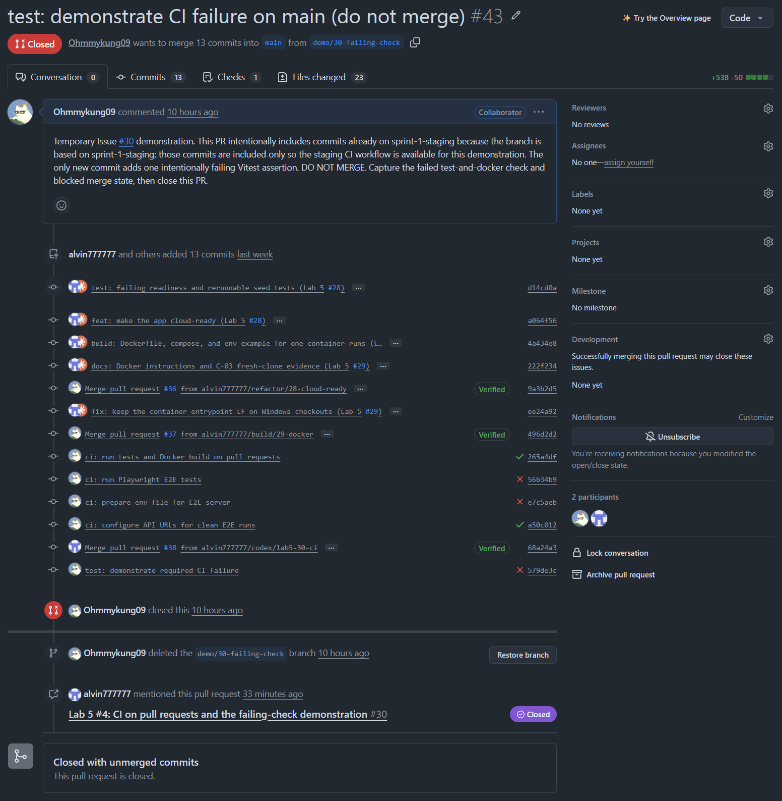

*Figure C-02. [PR #43](https://github.com/alvin777777/hairroot/pull/43), 22 November 2026: the temporary branch `demo/30-failing-check` into `main`. The last commit, `579de3c` "test: demonstrate required CI failure", has the failed `test-and-docker` check (✗). The PR was closed with unmerged commits, and its branch was deleted. This screenshot was taken after closing, so the merge box is not shown. The ruleset requires `test-and-docker` (Part 1 above).*

*Note:* the first attempt, [PR #40](https://github.com/alvin777777/hairroot/pull/40), branched from `main`, which did not have the workflow yet, so no check ran. It was closed unmerged and redone from `sprint-1-staging`.

## Answer Part 2: Docker and Reproducible Configuration

**Files.**
- [`Dockerfile`](https://github.com/alvin777777/hairroot/blob/sprint-1-staging/Dockerfile) builds in three stages (UI build, API build, runtime). The runtime runs as the non-root `node` user on port 3000, and the API serves the built UI.
- [`.dockerignore`](https://github.com/alvin777777/hairroot/blob/sprint-1-staging/.dockerignore) excludes every `.env` file.
- [`docker-compose.yml`](https://github.com/alvin777777/hairroot/blob/sprint-1-staging/docker-compose.yml) runs the database, a migrate-and-seed job, and the app.
- `.gitattributes` keeps shell scripts as LF, fixing the Windows defect found in review of #37.

**C-03: fresh clone.** From a fresh clone of `4a434e8`, with only `.env.example` values filled in ([full output](https://github.com/alvin777777/hairroot/blob/sprint-1-staging/docs/labs/lab-05/evidence/c03-fresh-clone-compose.txt)):

```text
$ cp .env.example .env && docker compose up --build -d
migrate: No pending migrations / Seeded demo data. Demo password not shown.
$ curl /api/health  -> {"status":"ok"}        $ curl /api/ready -> {"status":"ready"}
$ curl /            -> HTTP 200 <title>HairRoot</title>   (UI from the same container)
POST /api/auth/login (password from .env, not shown) -> HTTP 200
POST /api/bookings -> booking 1 "Docker check"
$ docker compose restart app ; GET /api/bookings/1 -> same booking
$ docker compose run --rm migrate (rerun migrations and seed) ; GET /api/bookings/1 -> same booking
$ docker compose exec app whoami -> node
$ docker image inspect: NODE_ENV, TZ, PORT only; no password or DATABASE_URL in the image
```

The ready response gained `"db": "connected"` in PR #39 for the smoke test.

**Configuration and secrets.** Every setting comes from the environment:
- [`server/.env.example`](https://github.com/alvin777777/hairroot/blob/sprint-1-staging/server/.env.example), [`client/.env.example`](https://github.com/alvin777777/hairroot/blob/sprint-1-staging/client/.env.example), and the root [`.env.example`](https://github.com/alvin777777/hairroot/blob/sprint-1-staging/.env.example) hold placeholders only.
- The environment table in [deployment.md](https://github.com/alvin777777/hairroot/blob/sprint-1-staging/docs/labs/lab-05/deployment.md) gives each variable's purpose, whether it is secret, and where its value comes from.

| Variable | Secret | GCP value from |
|---|---|---|
| `DATABASE_URL` | Yes | Secret Manager `hairroot-database-url` |
| `SEED_DEMO_PASSWORD` | Yes | Secret Manager `hairroot-demo-password` |
| `CLIENT_ORIGIN` | No | Both Cloud Run URLs, set by `deploy.sh` |
| `PORT`, `NODE_ENV`, `TZ` | No | Cloud Run and the image |
| `SEED_RESET` | No | Not set; refused in production |

Secret scanning and push protection are on. `.env` files are ignored by Git. A search of the full history for common credential patterns found none.

## Answer Part 3: GCP Deployment and Persistence

**GCP project.** The Free Trial is active on project `cpe334-hairroot`, with no credits used.

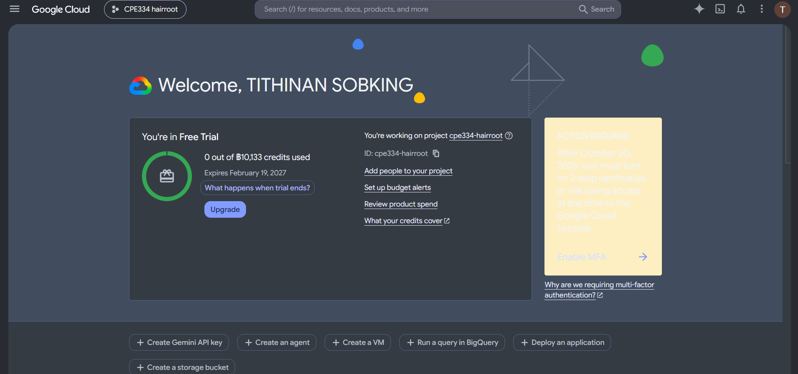

*Figure 1. Issue #27: the Free Trial is active on project `cpe334-hairroot`.*

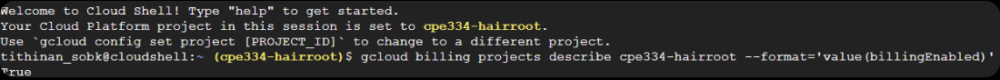

*Figure 2. Issue #27: in Cloud Shell, `billingEnabled` returns True for `cpe334-hairroot`.*

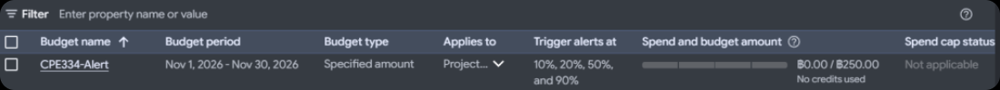

*Figure 3. Cost control: the alerts-only budget `CPE334-Alert`, THB 250, with alerts at 10, 20, 50, and 90 percent.*

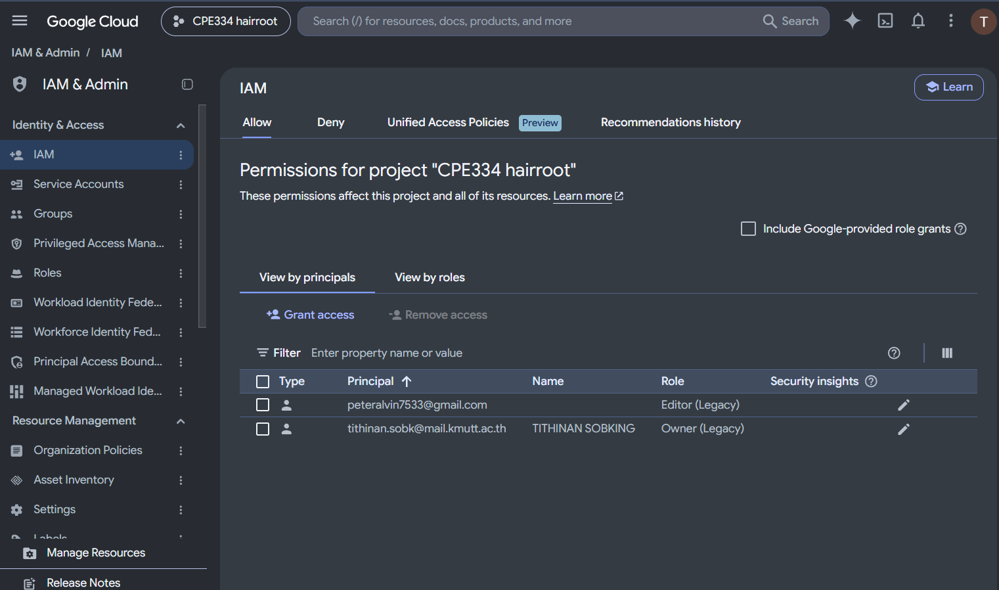

*Figure 4. Issue #27: ทิฐินันท์ is Owner, and ไอโว is Editor.*

**Resources.** These come from [`deploy/deploy.sh`](https://github.com/alvin777777/hairroot/blob/deploy/31-gcp-first-deploy/deploy/deploy.sh):
- Artifact Registry `hairroot`
- Cloud SQL PostgreSQL 16 `hairroot-pg` (`db-f1-micro`, storage auto-increase off)
- Secret Manager `hairroot-database-url` and `hairroot-demo-password`
- Cloud Run job `hairroot-migrate`
- Cloud Run service `hairroot` (min 0, max 3 instances)
- Runtime service account `hairroot-runner`

ทิฐินันท์ (project Owner) ran `deploy/deploy.sh` in Cloud Shell, after a dry run he reviewed on #39. 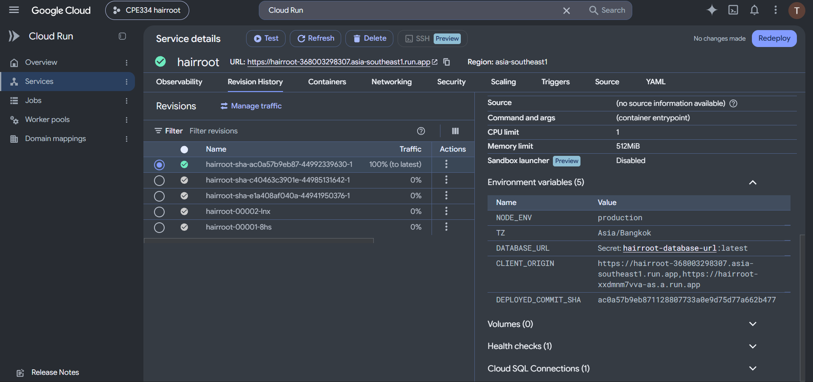

*Figure 9. Cloud Run service `hairroot` in `asia-southeast1`. The revision history shows the first deploys by `deploy.sh` (`hairroot-00001`, `-00002`) and the three pipeline releases. `hairroot-sha-ac0a57b9eb87-44992339630-1` serves 100%. Its environment shows `DEPLOYED_COMMIT_SHA` = `ac0a57b…`, both service URLs in `CLIENT_ORIGIN`, and `DATABASE_URL` only as a Secret Manager reference. There is one Cloud SQL connection.*

The Cloud SQL instance `hairroot-pg` appears as the service's Cloud SQL connection (Figure 9). The live `/api/ready` returns `"db":"connected"` (C-04 checks). No separate Cloud SQL Console figure is included.

**C-04: domain workflow on the public URL** (https://hairroot-368003298307.asia-southeast1.run.app). Every screenshot carries a banner with the real address and time, added by [`tools/pdf/capture-live.mjs`](https://github.com/alvin777777/hairroot/blob/sprint-1-staging/tools/pdf/capture-live.mjs).

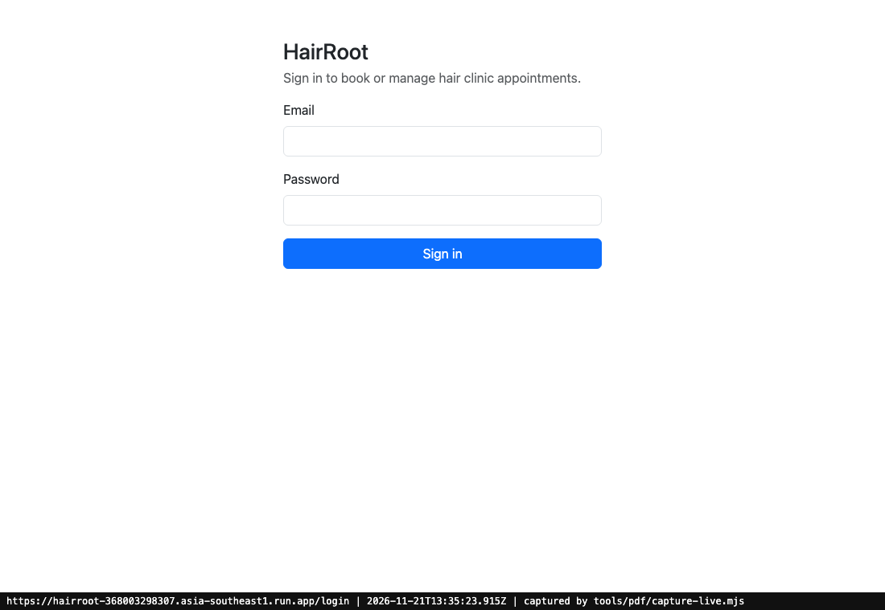

*Figure 5. C-04 (R-03): opening `/bookings` without signing in leads to the sign-in page on the live URL.*

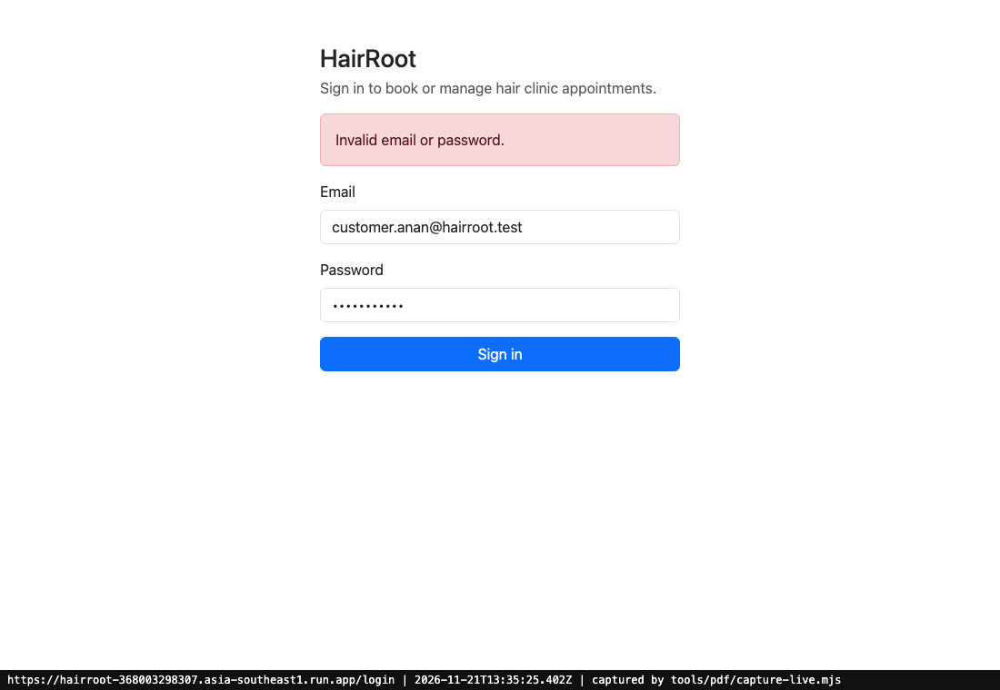

*Figure 6. C-04 (R-03): a wrong password is rejected on the live URL.*

**Signed-in journey on the live service** (ทิฐินันท์, 22 November 2026, 03:16 to 03:21, revision `e1a408a`):

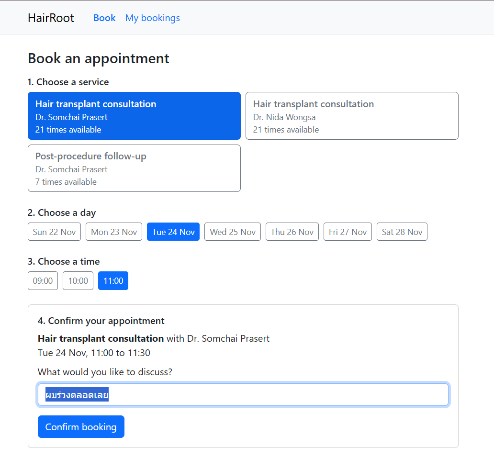

*Figure 7a. C-04: customer Anan chooses Hair transplant consultation with Dr. Somchai Prasert, Tue 24 Nov, 11:00 to 11:30, topic "ผมร่วงตลอดเลย".*

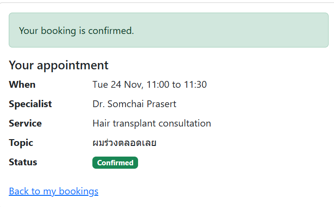

*Figure 7b. C-04: the booking is confirmed and saved.*

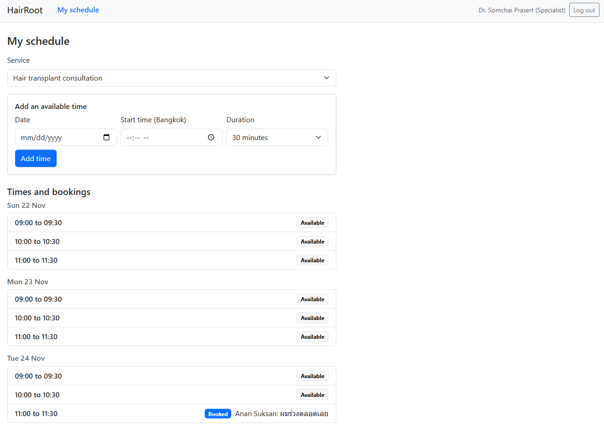

*Figure 7c. C-04 and C-05 "before": Dr. Somchai's schedule shows Tue 24 Nov, 11:00 to 11:30, as **Booked** by Anan Suksan with the topic.*

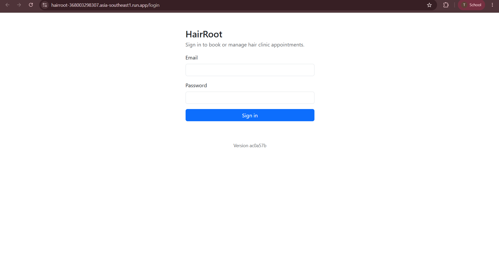

*Figure 7d. C-04: the browser address bar shows the live URL `hairroot-368003298307.asia-southeast1.run.app/login`, with "Version ac0a57b".*

The rule rejection and access restriction on the live URL are in Figure 6 (wrong password) and the live checks above (401 without a session, 403 from a foreign origin).

**UI, API, and database connectivity** (from [c04-live-checks.txt](https://github.com/alvin777777/hairroot/blob/sprint-1-staging/docs/labs/lab-05/evidence/c04-live-checks.txt), 21 November 2026, 13:35 UTC):

```text
GET /api/health                       -> 200 {"status":"ok"}
GET /api/ready                        -> 200 {"status":"ready","db":"connected"}
GET /                                 -> 200 <title>HairRoot</title>
GET /api/bookings/mine, no session    -> 401 UNAUTHENTICATED
POST /api/auth/login, own origin      -> 401 INVALID_CREDENTIALS (origin accepted)
POST /api/auth/login, foreign origin  -> 403 CSRF_REJECTED
```

**C-05: data survives a restart and a redeploy.** Before: Figures 7a to 7c, the booking "ผมร่วงตลอดเลย" for Tue 24 Nov, 11:00, created on revision `hairroot-sha-e1a408af040a-44941950376-1`. Since then the service was redeployed twice, through `hairroot-sha-c40463c3901e-44985131642-1` and `hairroot-sha-ac0a57b9eb87-44992339630-1` (Figure 9). Each release also reran the migration job and the seed, which never deletes data.

**Not captured at submission:** an "after" screenshot on revision `ac0a57b` showing this booking. The redeploys and the rerunnable seed are shown above, and C-03 shows locally that a booking survives a restart and a reseed. Live persistence after the redeploys is therefore not proven by a screenshot here.

## Answer Part 4: Repeatable Release Pipeline

**Keyless access.** [`deploy/setup-wif.sh`](https://github.com/alvin777777/hairroot/blob/deploy/31-gcp-first-deploy/deploy/setup-wif.sh) creates the deployer `hairroot-deployer`, which has no keys. Its roles are Cloud Run developer, Artifact Registry writer on `hairroot` only, and service account user on `hairroot-runner` only. It also creates Workload Identity Federation pool `github-actions` and provider `github-main`.

The provider accepts only tokens from `.github/workflows/deploy.yml` on `refs/heads/main` of this repository (owner ID 161717496, repo ID 1449523924), through environment `demo`. The GitHub environment `demo` allows deployment from `main` only. ทิฐินันท์ ran `setup-wif.sh` as Owner. ไอโว set the four non-secret variables on environment `demo` (`GCP_PROJECT_ID`, `GCP_REGION`, `WIF_PROVIDER`, `WIF_SERVICE_ACCOUNT`), and the environment holds no secrets. All three deploy runs below authenticated through WIF, with no service account key.

**C-06: one labelled change through the pipeline.** The visible change is the version footer.

1. [Issue #45](https://github.com/alvin777777/hairroot/issues/45), labelled `lab5`.
2. [PR #46](https://github.com/alvin777777/hairroot/pull/46) into `sprint-1-staging`, with failing tests first (`0c007a1`). ทิฐินันท์ reviewed it: *"the endpoint only exposes a validated 40-character DEPLOYED_COMMIT_SHA, and the footer shows its 7-character prefix on all routes."* `test-and-docker` passed.
3. Release PRs from `sprint-1-staging` into `main`, each requiring an approval and `test-and-docker`, after which `deploy.yml` ran:

| Release PR | Commit | Deploy run | Result |
|---|---|---|---|
| [#47](https://github.com/alvin777777/hairroot/pull/47) | `e1a408a` | [44941950376](https://github.com/alvin777777/hairroot/actions/runs/44941950376) | Deployed and serving, but the post-deploy check failed and stopped before the smoke test ([#48](https://github.com/alvin777777/hairroot/issues/48)) |
| [#50](https://github.com/alvin777777/hairroot/pull/50) | `c40463c` | [44985131642](https://github.com/alvin777777/hairroot/actions/runs/44985131642) | Same. The clearer message from #49 showed the running digest differs from the tag digest |
| [#52](https://github.com/alvin777777/hairroot/pull/52) | `ac0a57b` | [44992339630](https://github.com/alvin777777/hairroot/actions/runs/44992339630) | **Every step passed**, after #51 changed the check to repository, commit, and live version |

From run 44992339630:

```text
Service [hairroot] revision [hairroot-sha-ac0a57b9eb87-44992339630-1] has been deployed and is serving 100 percent of traffic.
Commit: ac0a57b9eb871128807733a0e9d75d77a662b477
Pushed tag digest: .../hairroot/hairroot@sha256:f4379144fda5...
Running image:     .../hairroot/hairroot@sha256:d6d223caa24a...
Cloud Run revision: hairroot-sha-ac0a57b9eb87-44992339630-1
PASS /api/health
PASS /api/ready
PASS /
SKIP login: optional smoke credentials are not configured
$ curl <URL>/api/version  ->  {"commit":"ac0a57b9eb871128807733a0e9d75d77a662b477"}
```

The two digests differ because the pushed tag points to an image index, while Cloud Run records the platform image it runs. The release check therefore verifies three things: the repository and digest pinning, the revision's commit, and the live version. The two failed runs show the pipeline stopping instead of reporting success it could not verify. Every merge into `main` here was a reviewed release PR, and nothing was pushed to `main` directly.

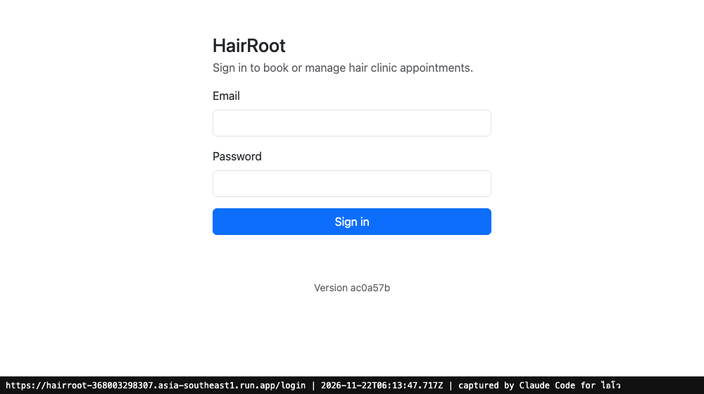

*Figure 7. C-06 (R-08): the live URL shows "Version ac0a57b". Its tooltip and `/api/version` give the full SHA `ac0a57b9eb871128807733a0e9d75d77a662b477`.*

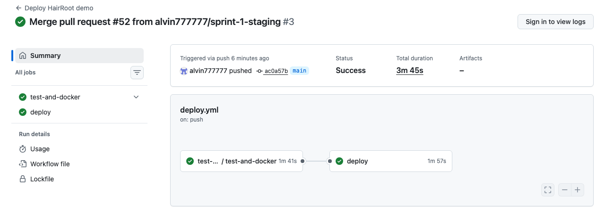

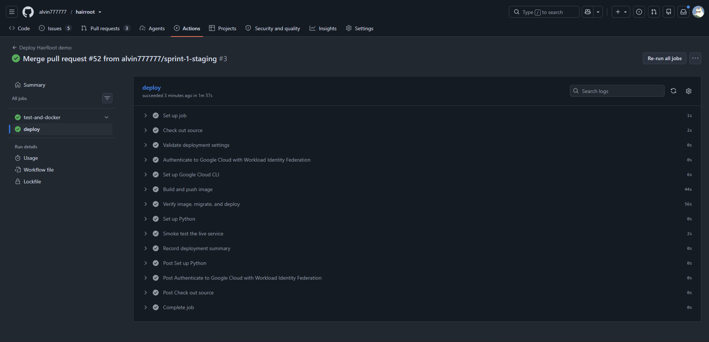

*Figure 8b. C-06 (R-07): the `deploy` job of run 44992339630 passed every step: WIF authentication, build and push, verify, migrate, and deploy, the smoke test, and the summary.*

*Figure 8. C-06 (R-07): [deploy run 44992339630](https://github.com/alvin777777/hairroot/actions/runs/44992339630), triggered by the merge of release PR #52 into `main` at `ac0a57b`. Both `test-and-docker` and `deploy` succeeded.*

**Release procedure.** This is summarised from [deployment.md](https://github.com/alvin777777/hairroot/blob/sprint-1-staging/docs/labs/lab-05/deployment.md#release-procedure).

1. Open an Issue labelled `lab5`, branch from `sprint-1-staging`, and open a PR into it. The teammate reviews, and `test-and-docker` must pass.
2. Open a release PR from `sprint-1-staging` into `main`. If GitHub asks, update the branch, because the ruleset requires it to be up to date. It needs an approval and `test-and-docker`.
3. Merging runs `deploy.yml`: CI again, then build, push with the full commit SHA tag, the migration job, the service update, the verification, and the smoke test.
4. To find the running commit, look at the footer *Version abc1234*, `GET /api/version`, the revision name `hairroot-sha-<12 chars>-<run id>-<attempt>`, or the run summary.
5. To roll back, use Actions > *Deploy HairRoot demo* > Run workflow on `main` with `image_tag` set to an earlier full commit SHA. This skips tests, build, and migration.

## AI use and limitations

**AI-use declaration.**

| Student | Tool | Tasks assisted |
|---|---|---|
| ไอโว | Claude Code (Claude Opus 5.5) | Adapting the kit's Docker, deploy, and WIF scripts; the cloud-ready changes and their tests; reviews of #38 after reading its runs; deployment.md; this PDF |
| ทิฐินันท์ | OpenAI Codex (GPT-6) only | Writing and reviewing the CI workflow (#38), the C-02 demonstration (#43), the deploy workflow and release scripts (#44), reviews of ไอโว's PRs, and GCP setup steps in Cloud Shell. No other AI tool was used. |

No password, connection string, or key was pasted into an AI chat.

**Limitations.**
- Lab 5 was due 15 November 2026, and this work continued after that date.
- The budget period ends on 30 November 2026. It should be extended to the Final Project deadline.
- **C-05 is incomplete:** the "before" booking and the two later redeploys are shown, but there is no "after" screenshot on revision `ac0a57b`.
- **No settings screenshots:** the ruleset settings page and the Cloud SQL instance have no Console screenshots. The ruleset is shown through the GitHub API output and enforced on PR #43, and Cloud SQL is shown through the service's connection and `/api/ready`.
- **PR #43 screenshot:** it was taken after the PR was closed, so it shows the failed check and the unmerged state, not the disabled merge button.
- **Smoke test login is skipped:** `SMOKE_EMAIL` and `SMOKE_PASSWORD` are not configured, so the smoke test does not sign in. Health, readiness with the database, and the UI are checked.
- **Two red deploy runs:** runs 44941950376 and 44985131642 deployed and served correctly, but their post-deploy check failed (#48). Fixing it took two attempts, because the first diagnosis (#49) was wrong.
