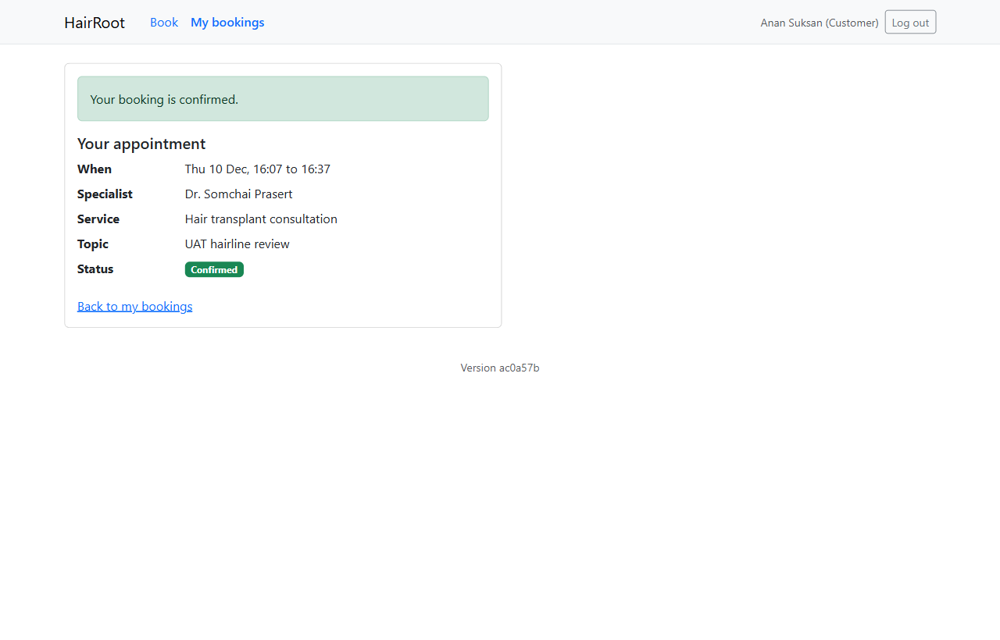
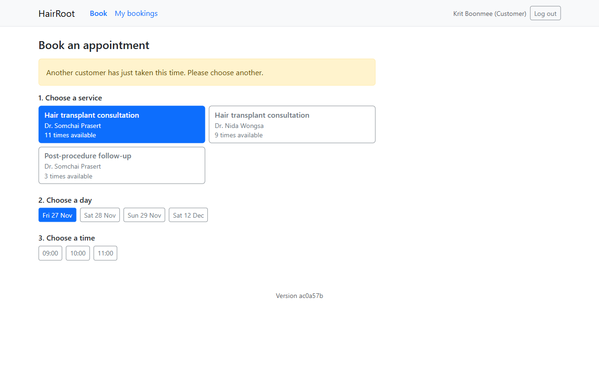
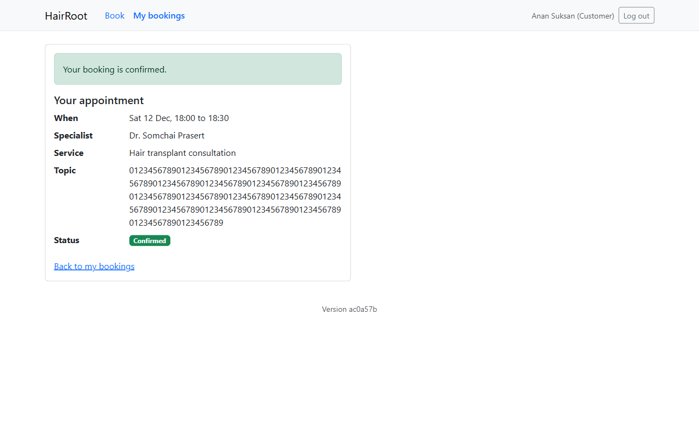
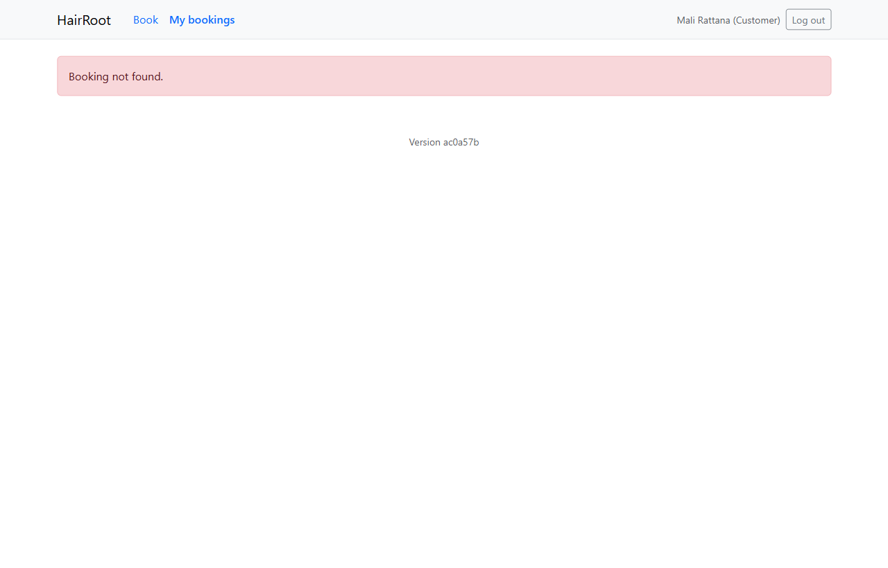
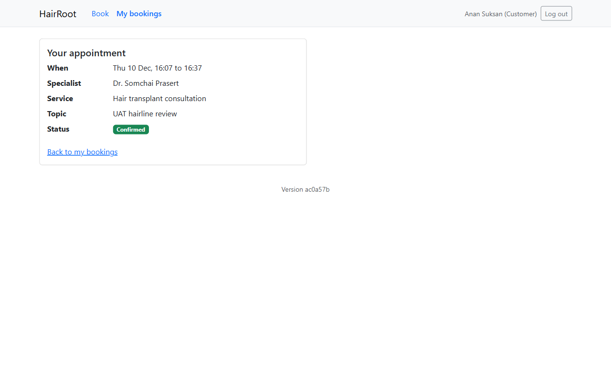
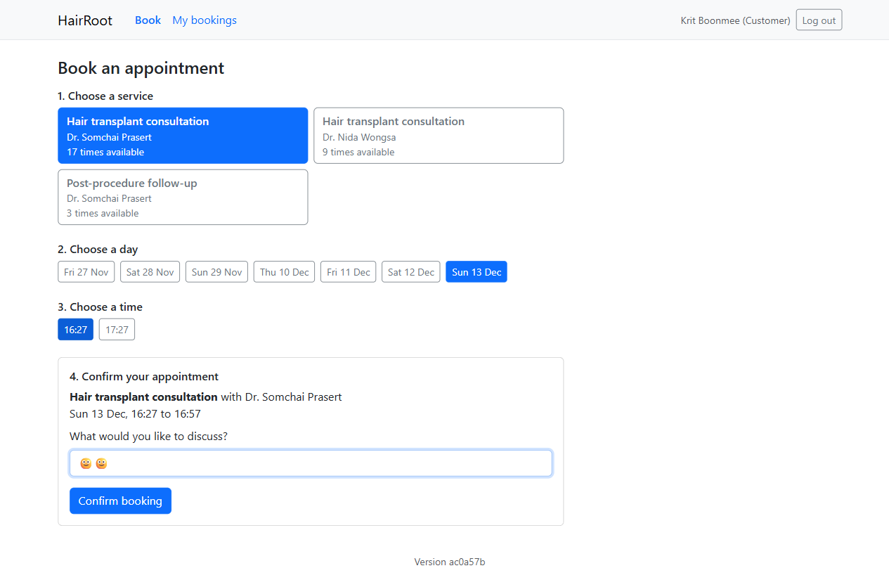
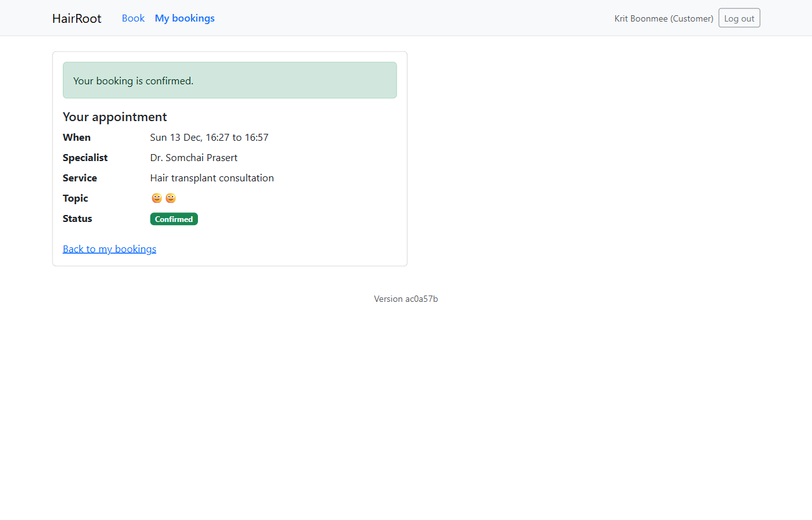
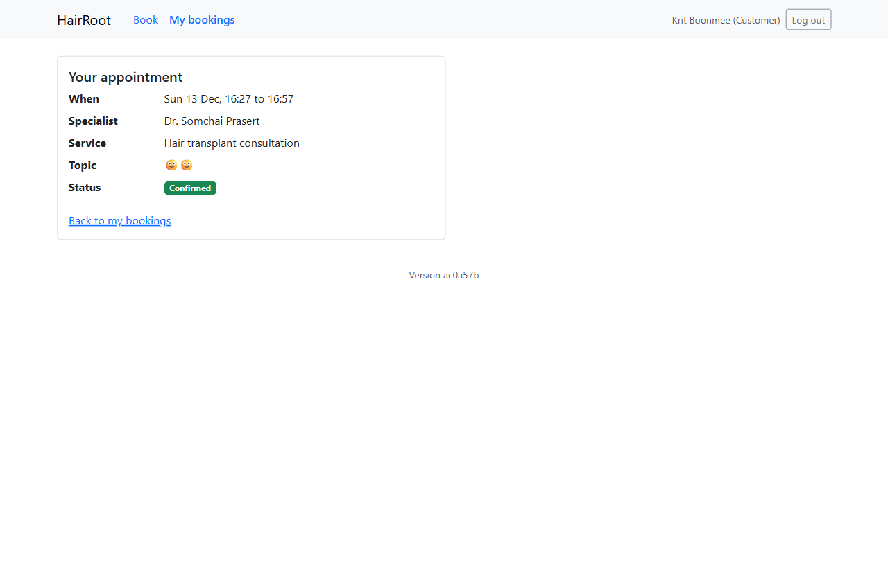

# CPE 334 Lab 6: Independent UAT and Defect Management

**HairRoot**, hair clinic appointment booking (Group Project Theme 1). Group **TH-060_P1**, section 131.

| | |
|---|---|
| **Students** | ไอโว ปีเตอร์ อัลวิน รันเน่, 67070501051, GitHub `alvin777777` ทิฐินันท์ สอบกิ่ง, 67070501018, GitHub `Ohmmykung09` |
| **Sprint 1 scope** | Sign-in and roles; a specialist adds times; a customer books by service, day, and time; exclusive booking; own-booking and own-schedule views (Part A, Section 1) |
| **Repository** | https://github.com/alvin777777/hairroot (public) |
| **Sprint 1 baseline** | Tag `v0.1.0-sprint1`, commit `d1e8d81` |
| **Tested release** | Commit `ac0a57b` on `main`, Cloud Run revision `hairroot-sha-ac0a57b9eb87-44992339630-1` |
| **Deployed URL** | https://hairroot-368003298307.asia-southeast1.run.app |
| **Partner team** | ซวยแล้วหนูคู่หูพี่มาแล้ว: Anapat Banjerdsilp (67070501049) and Siwarak Chatvichai (67070501086). Product DineQ, restaurant walk-in queue (Theme 9). Repository https://github.com/PpAnpt/dineq |
| **Independent UAT testers of HairRoot** | Anapat Banjerdsilp and Siwarak Chatvichai [PENDING: confirm both tested] |
| **Final UAT decision for HairRoot** | [PENDING: Accepted, Accepted with documented minor limitations, or Not Accepted, recorded by the partner team] |

<!-- TOC -->

## Version table

| Role | Commit or tag | Cloud Run revision | Notes |
|---|---|---|---|
| Sprint 1 baseline | `v0.1.0-sprint1` (`d1e8d81`) | — | Accepted Sprint 1 contract and scope |
| Release under UAT | `ac0a57b` | `hairroot-sha-ac0a57b9eb87-44992339630-1` | It adds the Lab 5 changes (Docker, CI/CD, version footer), with no Sprint 1 behaviour change, and the guided flow (C-02) |
| Defective commit(s), if any | [PENDING] | — | |
| Regression test (RED) | [PENDING] | — | |
| Fix (GREEN) and release PR | [PENDING] | [PENDING] | |
| Revision re-tested by the UAT team | [PENDING] | [PENDING] | |

Each release into `main` passes through `sprint-1-staging` as a merge commit, so a release commit on `main` differs from the staging commit it merges. The deployed footer *Version abc1234* and `GET /api/version` give the commit actually served.

## Part A: UAT preparation and handoff

**Cases.** HairRoot's six Sprint 1 UAT cases are in Appendix A, and they cover every required category:

| Category | Case | AC |
|---|---|---|
| Normal domain journey | UAT-01 | AC-10, AC-14, AC-15, AC-20, AC-22, AC-27 |
| Business rule | UAT-02 | AC-16 (AC-17 by automated T-17) |
| Boundary | UAT-03 | AC-11, AC-12, AC-15b |
| Forbidden role or ownership | UAT-04 | AC-05, AC-06, AC-21, AC-23 |
| State and persistence | UAT-05 | AC-14, AC-20, AC-22, AC-24 |
| Authentication | UAT-06 | AC-01, AC-02, AC-03 |

**Handoff.** Appendix A, Section 1 covers:
- the tested scope, and what is excluded as Sprint 2 or 3
- account labels S1, S2, and C1 to C3 with their roles, but no passwords
- data setup and independence: each case creates its own time; only UAT-05 follows UAT-01
- cleanup, and the rule that the Product Team announces deployments in advance
- how to report findings: the *UAT finding* Issue form, label `uat`

**Credentials.** The demo password is in Secret Manager. ทิฐินันท์ gave it to the UAT team privately [PENDING: date and channel, with no value]. It does not appear in this PDF, in Git, or in any screenshot.

**Automated support.** E2E tests cover the same paths as UAT-01, UAT-02, and UAT-04: T-31, T-32, and T-39 (added in PR #54). They run in CI on every PR. They support the UAT but do not replace independent testing.

**Sessions with the partner team.**

| Session | Date and time | Who | Release | Outcome |
|---|---|---|---|---|
| Handoff | [PENDING] | Both teams | [PENDING] | [PENDING] |
| Initial UAT of HairRoot (run R01) | 26 Nov 2026, 17:46 to 18:27 Bangkok | Siwarak Chatvichai (DineQ) [PENDING: Anapat's part] | `ac0a57b` (footer) | 5 PASS, 1 FAIL (UAT-07), 1 BLOCKED (UAT-05 step 4) |
| Our UAT of the partner product | [PENDING] | ไอโว and ทิฐินันท์ | [PENDING] | [PENDING] |
| Re-test after corrections | [PENDING] | Partner testers | [PENDING] | [PENDING] |

## Part B: Independent execution of the partner team's product

**Product tested.** DineQ (restaurant walk-in queue management, CPE 334 Theme 9) by ซวยแล้วหนูคู่หูพี่มาแล้ว.

| | |
|---|---|
| Release under test | Commit `17c8b90` on `main` (merge of their PR #42) |
| Cloud Run revision | `s21271a0d-00005-rdp` |
| URL | https://s21271a0d-4d7hbszvwq-as.a.run.app/login |
| Deploy evidence | https://github.com/PpAnpt/dineq/actions/runs/44986245220 |
| Cases received | [PENDING: their UAT case document and IDs] |

Both students tested together. Results are recorded as observed, not copied from expected results.

| Case | Tester | Date and time | Tested version | Inputs | Actual result | Result | Evidence |
|---|---|---|---|---|---|---|---|
| [PENDING: partner case ID] | [PENDING] | [PENDING] | [PENDING] | [PENDING] | [PENDING] | PASS / FAIL / BLOCKED | E-B1 |

[PENDING: evidence E-B1 and later. At least the normal journey and a negative or access case, each captioned with the evidence ID, action, expected and actual result, time, and tested version. For a rejected operation, also show that the protected state was not changed or disclosed.]

## Part C: Defect reporting and triage

### C.1 Findings we reported to the partner team

| ID | Case and requirement | Version | Steps, expected, and actual | Severity and user impact | Evidence | Partner's response |
|---|---|---|---|---|---|---|
| [PENDING: or "None: every case passed"] | | | | | | |

### C.2 Results of the independent UAT of HairRoot

DineQ ran HairRoot's cases v0.2 (UAT-01 to UAT-07) against the live service on 26 November 2026, run R01. The footer showed *Version ac0a57b* throughout. Their full record is `docs/labs/lab-06/hairroot-run-2026-11-26-R01.md` in https://github.com/PpAnpt/dineq (commit `26070fc`): 43 steps, 39 PASS, 3 FAIL, and 1 BLOCKED.

| Case | Result | What the UAT team observed |
|---|---|---|
| UAT-01 | PASS | Booking 4 confirmed, found again in *My bookings*, and shown to S1 with the customer and topic |
| UAT-02 | PASS | C2 won the time; C3's stale request got *Another customer has just taken this time*; neither list was wrong. Sequential, not concurrent |
| UAT-03 | PASS | Past start and overlap rejected; adjacent, 15- and 120-minute times accepted; topics of 2 and 201 characters rejected, 3 and 200 accepted |
| UAT-04 | PASS | C2 got *Booking not found.* for C1's booking; C2 was redirected from `/schedule`; a visitor was sent to sign-in; S2 saw only its own schedule |
| UAT-05 | BLOCKED | Steps 1 to 3 passed in a fresh session. Step 4 needs a redeployment announced by HairRoot, which had not happened |
| UAT-06 | PASS | Wrong and unknown credentials gave the same generic message; logout, Back, and reload returned to sign-in |
| UAT-07 | FAIL | The two-symbol topic `🙂🙂` was accepted as booking 2 and used up the time (finding HR-F01). The three-symbol control passed |

*HR-E01-05-R01. UAT-01 step 5, 26 Nov 2026 18:11:40 Bangkok, Version ac0a57b, actor C1. Action: C1 confirms a booking with topic `UAT hairline review`; expected: "Your booking is confirmed." with the details; actual: Booking 4 confirmed with the right time, specialist, service and topic.* **PASS**.

*HR-E02-04-R01. UAT-02 step 4, 26 Nov 2026 18:18:49 Bangkok, Version ac0a57b, actor C3. Action: C3 confirms the time C2 has just booked; expected: "Another customer has just taken this time"; T2 no longer offered; actual: The message shown; T2 removed from the list.* **PASS**.

*HR-E03-10-R01. UAT-03 step 10, 26 Nov 2026 18:14:03 Bangkok, Version ac0a57b, actor C1. Action: C1 books with the 200-character topic; expected: Booking confirmed with the full topic; actual: Booking 5 confirmed; detail shows all 200 characters.* **PASS**.

*HR-E04-02-R01. UAT-04 step 2, 26 Nov 2026 18:19:41 Bangkok, Version ac0a57b, actor C2. Action: C2 opens the address of C1's booking 4; expected: "Booking not found."; nothing of C1 shown; actual: Only "Booking not found."; no name, time or topic of C1.* **PASS**.

*HR-E05-01-DETAIL-R01. UAT-05 step 1, 26 Nov 2026 18:26:54 Bangkok, Version ac0a57b, actor C1. Action: C1 reopens booking 4 in a new browser session; expected: Same date, time and topic; actual: Unchanged and Confirmed; also shows C2's attempt in UAT-04 changed nothing.* **PASS**.

**Finding HR-F01 (UAT-07, BR-08, AC-15b).**

*HR-E07-02-INPUT-R01. UAT-07 step 2, 26 Nov 2026 18:03:12 Bangkok, Version ac0a57b, actor C3 Krit Boonmee. Action: C3 enters the topic `🙂🙂` (2 characters) for T7A; actual: The exact input before confirming.*

*HR-E07-02-AFTER-R01. UAT-07 step 2, 26 Nov 2026 18:03:39 Bangkok, Version ac0a57b, actor C3 Krit Boonmee. Action: C3 chooses Confirm booking; expected: "Enter a topic of 3 to 200 characters."; no booking; actual: Booking 2 confirmed with topic `🙂🙂`.* **FAIL**.

*HR-E07-02-PERSISTED-R01. UAT-07 step 2, 26 Nov 2026 18:06:04 Bangkok, Version ac0a57b, actor C3. Action: Booking 2 reopened later; expected: No such booking; actual: Still stored and Confirmed.* **FAIL**.

Screenshots are DineQ's, copied unchanged from their commit `26070fc`, with synthetic accounts and no passwords.

### C.3 Findings received about HairRoot

Every received finding is classified against the Sprint 1 contract. A failing requirement is never relabelled as an enhancement.

| Issue | Reporter | Case and requirement | Version | Classification | Reason, from the contract and evidence | Severity | Owner | Status |
|---|---|---|---|---|---|---|---|---|
| HR-F01 [PENDING: Issue number] | Siwarak Chatvichai (DineQ) | UAT-07 steps 2, 3, and 5; BR-08, AC-15b | `ac0a57b` | Accepted defect | AC-15b requires topics shorter than 3 characters to be rejected. `🙂🙂` is 2 characters but was stored. The cause is in `server/src/services/bookings.ts`: `topic.length` counts UTF-16 code units, so `"🙂🙂".length` is 4 | Minor: no access or data loss, but an invalid booking is saved and uses up a time | ทิฐินันท์ | [PENDING: open, fixed in, re-tested] |

### C.4 Accepted minor limitations

[PENDING: minor defects the UAT team explicitly accepted as known limitations, with their confirmation, or "None"]

## Part D: Resolution and independent re-test

### D.1 Accepted-defect chain

[PENDING: for each corrected release-blocking defect: the Issue; the regression test excerpt with RED output on the defective commit; the fix diff; GREEN output with the existing regression tests; the teammate's PR review; CI; the release PR into `main`; the deploy run and revision; the post-deployment smoke check; and the partner's re-test. If HairRoot had no legitimate defect, record the TA's controlled defect exercise here instead, on an isolated branch (Lab 6 Section 3.5).]

### D.2 Independent acceptance decision for HairRoot

Only the UAT team can confirm acceptance.

| | |
|---|---|
| Decision | [PENDING: Accepted / Accepted with documented minor limitations / Not Accepted] |
| Tested release and revision | [PENDING] |
| UAT testers (team and names) | [PENDING] |
| Date | [PENDING] |
| Conditions or reasons | [PENDING] |
| Record | [PENDING: link to or screenshot of the partner's written decision] |

## Contributions, AI use, and limitations

| Work | ไอโว | ทิฐินันท์ |
|---|---|---|
| UAT cases and handoff (PR #42) | Wrote the cases and checked the expected messages against a local run | Reviewed them against the contract and the live app, requested the boundary and AC-17 corrections, and confirmed the release and revision |
| E2E for UAT-04 (PR #54) | Reviewed it and ran it locally (4/4, twice) | Wrote it |
| Testing the partner product | [PENDING] | [PENDING] |
| Findings, triage, and fixes | [PENDING] | [PENDING] |
| This report | Structure and evidence | Checked accuracy [PENDING: confirm] |

| Student | AI tool | Tasks assisted |
|---|---|---|
| ไอโว | Claude Code (Claude Opus 5.5) | Drafting the UAT cases and this report; the browser check of the expected results; reviewing PR #54 |
| ทิฐินันท์ | OpenAI Codex (GPT-6) | Adding E2E test T-39; reviewing PR #42 |

No password or secret was given to an AI tool.

**Limitations.**
- [PENDING: anything not completed, BLOCKED cases, unresolved dependencies, and any TA notification about the partner team]

## Appendix A: HairRoot Sprint 1 UAT cases and handoff

The full handoff document given to the partner team follows.
