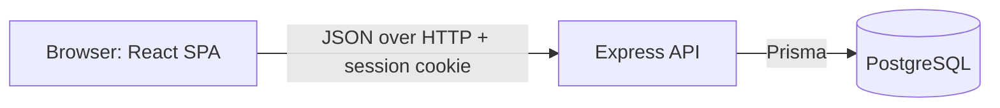
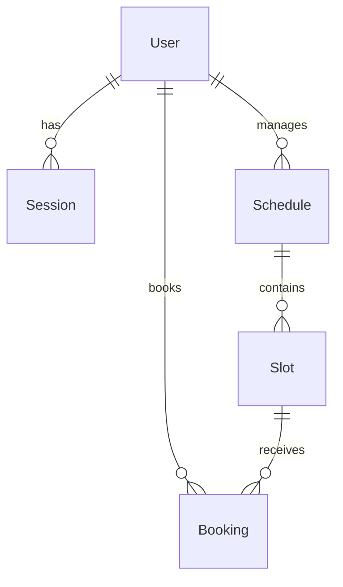

# HairRoot — System-Level Software Design

Version 0.3 — draft, 2026-11-09, pending teammate review.

## 1. Architecture and stack

HairRoot is a modular monolith with three logical layers.

| Layer | Technology | Responsibility |
|---|---|---|
| UI | React, TypeScript, Vite, Bootstrap | Screens, navigation, and input feedback. It holds no authorisation or business decisions. |
| API and application | Node.js, Express, TypeScript | Authentication, role and ownership guards, validation, and business rules. |
| Database | PostgreSQL, Prisma | Durable storage and the final guard on integrity, including exclusive booking. |
| Tests | Vitest, Supertest, Testing Library, Playwright | Unit, API and database integration, component, and end-to-end tests. |

Both students used this stack in Labs 1 to 4, and the course encourages reusing it. A single
container can serve the API and built client later, which suits Lab 5.

Business rules live in `server/src/services`. Routes parse the request and apply guards. Rules that
must hold under concurrency are also enforced by database constraints.

## 2. Data model

| Entity | Important fields | Constraints and ownership |
|---|---|---|
| User | `id`, `email`, `name`, `passwordHash`, `role` | `email` unique. `role` is `CUSTOMER` or `STAFF`. |
| Session | `id`, `tokenHash`, `userId`, `expiresAt` | `tokenHash` unique. Deleted with its user. |
| Schedule | `id`, `name`, `specialistId` | `specialistId` must reference a `STAFF` user, checked by the application. |
| Slot | `id`, `scheduleId`, `startAt`, `endAt` | Check `endAt > startAt`. Overlap and duration rules are enforced in a transaction by the service layer. |
| Booking | `id`, `slotId`, `customerId`, `topic`, `status`, `createdAt` | `status` is `ACTIVE` in Sprint 1. Partial unique index on `slotId` where `status = 'ACTIVE'`. |

Slot overlap is prevented by a PostgreSQL exclusion constraint using `btree_gist` on `scheduleId` and
the slot's time range, so it also holds when two requests compete. The service checks first so that it
can return a clear message, and maps a constraint violation to the same error.

All timestamps are stored in UTC and displayed in Asia/Bangkok.

**Setup.** Prisma migrations create the schema. Partial indexes and exclusion constraints are added
in reviewed raw SQL within those migrations. `npm run prisma:seed` resets the demo data to a known
state with synthetic accounts, schedules, and slots.

## 3. User interface

| Route | Role | Purpose |
|---|---|---|
| `/` | Anonymous, Customer, Staff | Public Home and aggregate booking activity; actions lead to sign-in or the role's dashboard. |
| `/login` | Anonymous | Sign in. |
| `/slots` | Customer | Browse available slots and book one. |
| `/bookings` | Customer | List own bookings. |
| `/bookings/:id` | Customer | Read one booking. |
| `/schedule` | Staff | Pick an assigned schedule, create slots, and see its slots and bookings. |

A navigation bar shows the user's name, their role's links, and Log out. After login each role goes
to its home page, and opening a route for another role redirects there.

Shared behaviour:

- Every data screen has distinct loading, empty, and error states.
- Field errors appear beside their fields, and form buttons are disabled while submitting.
- A 401 response returns the user to the login page.
- When a booking fails because the slot was taken, the message says so and the list refreshes.

## 4. API conventions

- JSON under `/api`, with resource-based paths.
- `POST` returns 201 with the created resource.
- Errors have the shape `{ "error": "Readable message", "code": "MACHINE_CODE", "fields": { ... } }`,
  and `fields` appears only for validation errors.
- Internal details and stack traces are never returned.

| Method and path | Access | Purpose |
|---|---|---|
| `GET /healthz` | Public | Readiness probe; returns only `{ "status": "ok" }`. |
| `GET /api/public/popularity` | Public | Seven-day aggregate booking counts by Bangkok date; no appointment or customer details. |

Both public routes require no session. The popularity endpoint returns exactly seven calendar-date
buckets and a total; all other API resources keep their role and ownership checks.

| Status | Meaning |
|---|---|
| 400 | Invalid input (`VALIDATION_ERROR`) |
| 401 | Not authenticated (`UNAUTHENTICATED`, `INVALID_CREDENTIALS`) |
| 403 | Wrong role or unassigned schedule (`FORBIDDEN`), or a rejected origin (`CSRF_REJECTED`) |
| 404 | Missing resource, or a booking owned by someone else (`NOT_FOUND`), so its existence is not revealed |
| 409 | Business conflict (`SLOT_TAKEN`, `SLOT_OVERLAP`) |
| 422 | Rule failure on valid input (`SLOT_IN_PAST`, `SLOT_NOT_BOOKABLE`) |

## 5. Roles and permissions

| Operation | Anonymous | Customer | Staff |
|---|---|---|---|
| View public booking activity | Yes | Yes | Yes |
| Log in | Yes | Yes | Yes |
| Log out; read own identity | No | Yes | Yes |
| List available slots | No | Yes | No |
| Create a booking | No | Yes, owned by self | No |
| List own bookings; read a booking | No | Own only | No |
| List own assigned schedules | No | No | Yes |
| Create slots on a schedule | No | No | Assigned only |
| Read a schedule's slots and bookings | No | No | Assigned only |

Each rule is enforced by backend guards and tested through the API. Hiding a button is only a
convenience in the UI.

## 6. Authentication and sessions

- **Passwords:** salted scrypt hashes, compared in constant time. Unknown email and wrong password
  return the same response.
- **Sessions:** login creates a random 256-bit token. Only its SHA-256 hash is stored.
- **Cookie:** `httpOnly`, `SameSite=Lax`, and `Secure` in production, with an absolute lifetime of 8 hours.
- **Current user:** `GET /api/auth/me` resolves the user from the session on each request.
- **Logout:** deletes the session row and clears the cookie, so the token cannot be reused.
- **CSRF:** state-changing requests must carry an `Origin` matching `CLIENT_ORIGIN`.

## 7. Configuration and delivery

| Variable | Purpose | Local example |
|---|---|---|
| `DATABASE_URL` | PostgreSQL connection | Local Docker database URL with development-only credentials |
| `PORT` | API port | `3001` |
| `CLIENT_ORIGIN` | Allowed browser origin | `http://localhost:5173` |
| `NODE_ENV` | Runtime mode; `production` enables secure cookies | `development` |

Only `.env.example` files are committed. `.env` files are ignored by Git, seeded passwords are
synthetic, and the client bundle contains no secrets.

**Planned GCP deployment (Lab 5).** Artifact Registry stores the Docker image, Cloud Run runs the
container, and Cloud SQL for PostgreSQL provides durable storage. Secret Manager supplies
`DATABASE_URL`, and migrations run as a pipeline step before release. The API serves the built client,
so the application has one origin. The exact resources follow the Lab 5 instructions.
